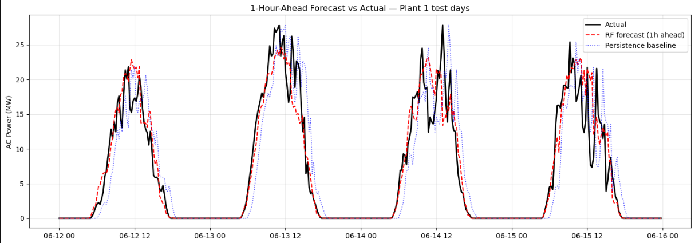
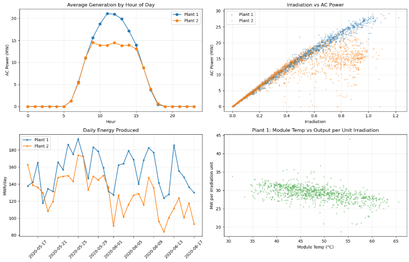
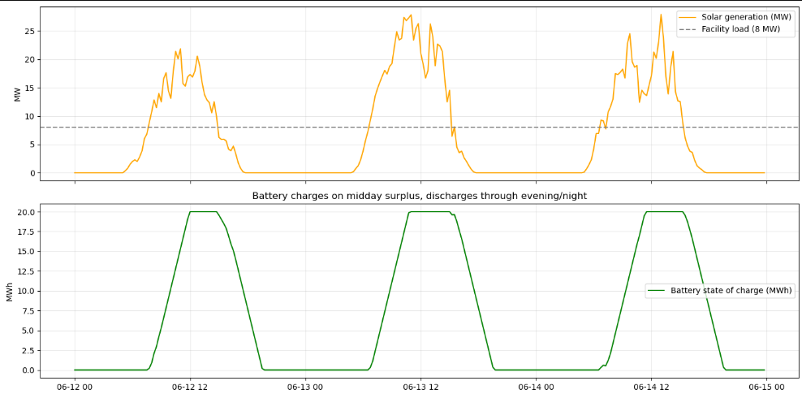

# Solar Power Forecasting & Smart Energy Optimization

End-to-end analysis of two utility-scale solar plants in India: 

**MySQL** data pipeline → data-quality audit → EDA → **1-hour-ahead generation forecasting** (benchmarked against naive baselines) → forecast-driven **battery storage simulation**.

## Data

[Kaggle - Solar Power Generation Data](https://www.kaggle.com/datasets/anikannal/solar-power-generation-data)

## Key results
 
| What | Result |
|---|---|
| 1-hour-ahead forecast (Random Forest + lag features) | MAE 1,370 kW, R² 0.88 i.e **40% lower error than persistence baseline** |
| LSTM comparison (same split, same metrics) | MAE 1,795 kW, R² 0.84 which beats all baselines but loses to RF on only 34 days of data |
| Faulty equipment found via SQL audit | 2 inverters at ~10% underperformance with 42 zero-output-in-full-sun events; separate 9-day, 4-inverter outage at Plant 2 |
| Battery simulation (20 MWh, 8 MW load, test week) | **19% reduction in grid energy** (~₹6 lakh/week at ₹4/kWh); 313 MWh curtailed indicating the battery is undersized |
| Plant comparison | Plant 2 produced ~21% less energy than Plant 1 under near-identical weather |
| Physics check | Module temperature vs output-per-unit-irradiation: r = −0.52 (heat reduces panel efficiency) |

## Forecast quality
 
1-hour-ahead model predictions vs actual generation on unseen test days. The persistence baseline is structurally "one hour late" on every ramp; the Random Forest anticipates them:

 
| Model | MAE (kW) | R² | MAE daytime | R² daytime |
|---|---|---|---|---|
| Persistence (naive) | 2,287 | 0.767 | 4,416 | 0.454 |
| Yesterday same time | 1,861 | 0.786 | 3,714 | 0.492 |
| Linear Regression | 2,164 | 0.832 | 3,392 | 0.628 |
| LSTM | 1,810 | 0.836 | - | - |
| **Random Forest** | **1,370** | **0.883** | **2,731** | **0.722** |
 
Daytime-only metrics are reported because nighttime zeros (~half the data) inflate overall scores.
## Exploratory analysis
 

 
## Battery simulation
 
The battery completes one full cycle per day, filling on midday surplus (the flat top at 20 MWh is curtailed energy), covering the early-evening deficit, empty by night:
 


 ## Repo structure
 
```
├── README.md
├── solar_forecasting_final.ipynb   # full analysis, outputs included
├── sql/
│   ├── 01_create_tables.sql        # MySQL schema
│   ├── 02_load_data.sql            # LOAD DATA with date-format handling
│   ├── 03_data_cleaning.sql        # plant-level cleaned tables (AVG×22 correction)
│   └── 04_analysis_queries.sql     # joins, RANK()/LAG() window functions, fault detection
├── images/                         # exported charts 
└── data/                           
```

## What makes this more than a model-fitting exercise
 
1. **Data-quality issues found and fixed, not ignored**
   - Plant 1 stores dates as `DD-MM-YYYY` while the other files use ISO format, so all dates are parsed with explicit formats to avoid silent day/month misparsing.  
   - Generation data is per-inverter but weather is per-plant, so generation is aggregated to plant level *before* joining (a naive join would duplicate every weather reading 22×).
   - ~28%of Plant 2 timestamps had inverters missing, so plant totals use `AVG(power) × 22` instead of `SUM` to avoid understating output.
2. **Honest forecasting.** Predicts t+1h using only information available at time t (lags of power/irradiation, time of day (no future weather)). The train/test split is time-based, never shuffled, and every model must beat two naive baselines.
3. **Deep learning tested, not assumed.** The LSTM (proper consecutive 6-hour sequences with gap checks) beats the baselines but not the feature-engineered Random Forest which is the expected outcome at this data scale, and a deliberate finding about matching model complexity to data volume.

4. 2. **Honest forecasting.** Predicts t+1h using only information available at time t: lags of power and irradiation, plus time of day. No future weather is used. The train/test split is time-based, never shuffled, and every model must beat two naive baselines.
3. **Deep learning tested, not assumed.** The LSTM uses proper consecutive 6-hour sequences with gap checks. It beats the baselines but not the feature-engineered Random Forest, which is the expected outcome at this data scale, and a deliberate finding about matching model complexity to data volume.
5. **Business framing.** Forecasts feed a unit-consistent battery dispatch simulation (kW × 0.25 h = kWh) with quantified grid savings and a sizing recommendation based on the 313 MWh/week of curtailed surplus.

 
## Limitations
Single season (34 days); no ground-truth weather forecasts available for this dataset; battery model excludes round-trip efficiency and degradation.

## Next steps
Add numerical weather forecast features (largest expected accuracy gain); extend to multi-horizon forecasts (4h, 24h); battery capacity sweep to price the curtailed 313 MWh/week; time-of-use tariff optimization.
 
## Tools
 


 
